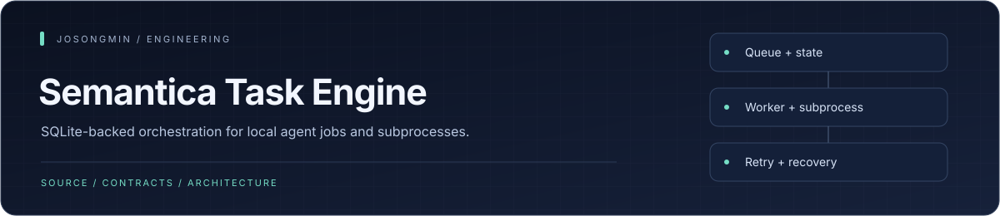
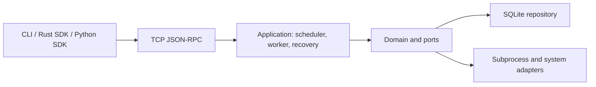

<p align="center"></p>

# Semantica Task Engine

<p align="center"><a href="#engineering-highlights">Engineering</a> · <a href="#architecture-at-a-glance">Architecture</a> · <a href="#build-and-run">Get started</a> · <a href="#documentation">Reference</a></p>

A Rust orchestrator for local development-agent jobs. It separates SQLite-backed job state, subprocess execution, retry/recovery, and JSON-RPC delivery into explicit layers.

## Engineering highlights

| Mechanism | Engineering purpose | Source |
| :--- | :--- | :--- |
| **Durable job state** | A SQLite-backed repository records jobs and their lifecycle instead of keeping the queue only in memory. | [SQLite adapter](crates/infra-sqlite/) |
| **Separated execution concerns** | Worker, scheduler, recovery, and maintenance responsibilities live behind core ports. | [Core ports](crates/core/) |
| **Explicit external interfaces** | A TCP JSON-RPC API serves CLI and SDK clients; the default development port is 9527. | [RPC API](crates/api-rpc/) |
| **Operational adapters** | Subprocess execution and system probes are distinct infrastructure adapters, with optional telemetry wiring. | [System adapters](crates/infra-system/) |

## Architecture at a glance



## Design

| Layer | Responsibility |
| --- | --- |
| Domain | Jobs, state transitions, priorities, and generation-based supersession |
| Application | Workers, scheduling, recovery, and maintenance |
| Persistence | SQLite, WAL, and transactional job state |
| Execution | Subprocesses, termination signals, and system probes |
| Interfaces | JSON-RPC, CLI, and Rust/Python SDKs |

The implementation covers backoff, deadlines, TTL, idle/charging/event conditions, and restart recovery. Consult [Cargo.toml](Cargo.toml) and the owning crates for the current composition.

## Build and run

```sh
cargo build --release
./target/release/semantica
```

The documented default RPC port is `9527`. Configure the database, port, and log format in the runtime environment:

```sh
SEMANTICA_DB_PATH=~/.semantica/meta.db \
SEMANTICA_RPC_PORT=9527 \
SEMANTICA_LOG_FORMAT=json \
  ./target/release/semantica
```

## CLI example

```sh
./target/release/semantica-cli enqueue \
  --job-type INDEX_FILE \
  --queue default \
  --subject "src/main.rs" \
  --priority 0 \
  --payload '{"path":"src/main.rs"}'

./target/release/semantica-cli status
./target/release/semantica-cli logs <job-id>
./target/release/semantica-cli cancel <job-id>
```

## Development checks

```sh
cargo fmt --check
cargo clippy --all-targets -- -D warnings
cargo test --all
```

## Status

This repository retains an earlier local orchestration implementation. Historical phase checklists and measurements describe their original development snapshot, not current operating qualification or performance guarantees. Long-running operation, recovery, and deployment require separate verification.

## Documentation

- [Quick start](QUICK_START.md)
- [Usage guide](USAGE_GUIDE.md)
- [Project overview](PROJECT_OVERVIEW.md)
- [Risk analysis](RISK_ANALYSIS.md)
- [Rust SDK](crates/sdk/README.md)
- [Python SDK](python-sdk/README.md)

<p align="center"><sub><a href="https://github.com/josongmin">Project map</a> · <a href="#engineering-highlights">Back to overview</a></sub></p>
